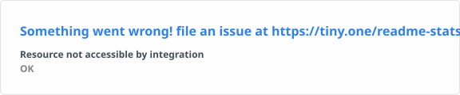
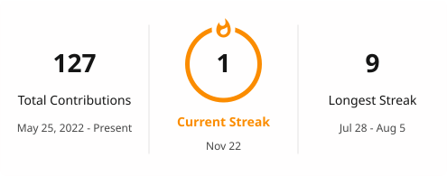

  
  
  
  

---

### 🧑‍💻 About Me

I'm an **AI/ML engineer** who builds working systems end to end, from data pipelines and model training to APIs, dashboards and full-stack apps. My habit: **compute a baseline first, then measure whether the "improvement" actually helped.**

- 🎓 **M.Tech, CSE (AI/ML)** at **LNMIIT Jaipur** (2025 – 2027) · **B.Tech Hons, CSE (AI/ML)** from **UPES Dehradun**
- 🧠 **Focus areas:** LLMs & RAG · LLM evaluation & hallucination detection · Deep RL · Computer Vision
- 🛠️ **I ship:** Python ML pipelines, Streamlit dashboards, REST APIs, MERN apps
- 🌱 **Currently building:** hallucination detection for diffusion LLMs (M.Tech thesis) and **Rasoi**, a full-stack recipe platform
- 💼 **Open to:** full-time roles as **AI/ML Engineer, Data Scientist or Software Engineer (ML)** from 2027

---

### 🚀 Featured Projects

| Project | What it does & what I found | Stack |
|:--|:--|:--|
| 🔎 **[RAGScope](https://github.com/ankursingh365/RAGScope)** RAG evaluation framework · [**live demo**](https://ragscope.streamlit.app/) | Benchmarks **6 RAG pipelines** on HotpotQA multi-hop QA, changing one component at a time. The plain dense baseline **beat hybrid BM25 and cross-encoder reranking by 10–16 points** of answerable rate, at **1/2000th the latency** (0.31 ms vs ~700 ms). Includes a hand-built faithfulness metric (0 parse failures on 150 answers) and a test suite. | Python · Ollama · Gemini API · Streamlit · pytest |
| 🧪 **[TRIAGE](https://github.com/ankursingh365/triage-dlm)** 🚧 Hallucination detection for diffusion LLMs (M.Tech thesis) | Detects wrong answers from **LLaDA-8B** and **Dream** by reading their denoising traces. I **re-implemented two detectors from papers that released no code** (TraceDet, ICLR 2026, and DynHD) and evaluate each one per failure mode. Built a custom multi-domain TechQA dataset; GPU jobs run on **Modal**. | PyTorch · Hugging Face Transformers · Modal |
| 🍛 **[Rasoi](https://github.com/ankursingh365/Rasoi-Recipe-Platform)** 🚧 "Cook with what you have" | Full-stack MERN app that finds Indian dishes you can cook from your pantry, plans your week and builds the grocery list. Uses **5,909 cleaned recipes** and **1,419 ingredients with Hindi/regional aliases**. JWT auth, Zod validation, Helmet and rate limiting; AI assistant in progress. | React · Vite · Node · Express 5 · MongoDB |
| 🤖 **[RL Projects](https://github.com/ankursingh365/Reinforcement_Learning-Projects)** Every agent checked against ground truth | **8 tabular algorithms** from scratch on Taxi, compared to the exact optimum (Dyna-Q is **7× more sample-efficient**). A Tic-Tac-Toe agent checked against a perfect solver over **845,661 states**. A **DQN self-driving agent** reaches 87% success on unseen tracks, and the project shows how single-map training overfits (100% on that map → 25% on new ones). | PyTorch · Gymnasium · NumPy |
| 🎭 **[Deepfake Detection](https://github.com/ankursingh365/Deefake-Detection-using-long-term-recurrent-CNN)** Video forensics web app | **ResNeXt-50 + LSTM** (long-term recurrent CNN) classifies videos as real or fake from face frames, served through a **Flask** app with heat-map output | PyTorch · OpenCV · Flask |
| 🛰️ **[LULC Classification](https://github.com/ankursingh365/LULC-Classification)** Published in IEEE | Land-use change detection on Landsat imagery (2010 – 2020) with Google Earth Engine. **SVM reached 92% accuracy** and detected a **+112% urban expansion**. | Python · GEE · scikit-learn |

<b>📂 More projects</b>

 

| Repo | Highlights |
|:--|:--|
| [Rubiks-Cube-Solver](https://github.com/ankursingh365/Rubiks-Cube-Solver) | IDA* heuristic search that solves any scrambled 3×3 cube |
| [Voreo_Bluetooth_car_robot](https://github.com/ankursingh365/Voreo_Bluetooth_car_robot) | Voice/Bluetooth-controlled robot car with ultrasonic + IR collision avoidance (IIT Delhi Robotics programme) |
| [Computer-Vision](https://github.com/ankursingh365/Computer-Vision) | Face-recognition attendance, finger counter (hand tracking), ball tracking, digit recogniser |
| [Machine-Learning](https://github.com/ankursingh365/Machine-Learning) | Credit-card fraud detection, XGBoost tuning, commodity price forecasting, CNN object detection |
| [Data-Science-Projects](https://github.com/ankursingh365/Data-Science-Projects) | 12 projects: customer segmentation, sentiment analysis, market-basket analysis, HR analytics, SQL |
| [University-Management-System](https://github.com/ankursingh365/University-Management-System) | Java desktop application for managing students, faculty and records |
| [React-Projects](https://github.com/ankursingh365/React-Projects) · [WEBSITE-CLONES](https://github.com/ankursingh365/WEBSITE-CLONES) | Myntra, Amazon, Netflix and Hotstar clones, social media UI, to-do apps |
| [C-Projects](https://github.com/ankursingh365/C-Projects) · [Python-Games](https://github.com/ankursingh365/Python-Games) | Bank management system, Sudoku solver, Snake, KBC, a "Jarvis" voice assistant |

---

### 🛠️ Tech Stack

**Languages** 
&nbsp;
&nbsp;
&nbsp;
&nbsp;
&nbsp;

**AI / ML & Data** 
&nbsp;
&nbsp;
&nbsp;
&nbsp;
&nbsp;
&nbsp;
&nbsp;

 

**Web & Backend** 
&nbsp;
&nbsp;
&nbsp;
&nbsp;
&nbsp;
&nbsp;

**Tools & Robotics** 
&nbsp;
&nbsp;
&nbsp;
&nbsp;
&nbsp;

---

### 🏆 Highlights

- 🎯 **GATE 2025** qualified, awarded the **AICTE GATE Scholarship**
- 📄 **IEEE publication** (2024): *LULC Classification for Temporal Analysis on Ganjam District, Odisha using Remote Sensing and GEE* · <!-- TODO: paste IEEE Xplore link --> [Paper](#) · [Code](https://github.com/ankursingh365/LULC-Classification)
- 💻 **TCS NQT-IT** (Oct 2023): 70.66% overall

---

### 📊 GitHub Stats

<!-- Cards are generated daily by .github/workflows/profile-cards.yml, so no third-party server can break them -->

<picture>
  <source media="(prefers-color-scheme: dark)" srcset="./profile/stats-dark.svg">
  
</picture>
<picture>
  <source media="(prefers-color-scheme: dark)" srcset="./profile/top-langs-dark.svg">
  
</picture>

<picture>
  <source media="(prefers-color-scheme: dark)" srcset="./profile/streak-dark.svg">
  
</picture>

<picture>
  <source media="(prefers-color-scheme: dark)" srcset="./profile/snake-dark.svg">
  
</picture>

---

  💡 Building useful AI and measuring it honestly. Let's connect if your team is hiring!

